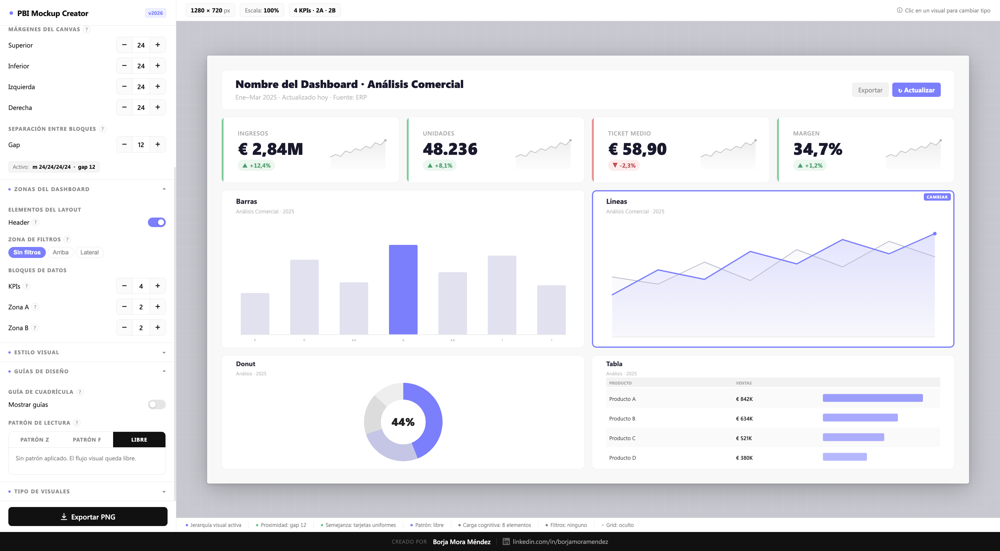

# PBI Mockup Creator

**Diseño la estructura de mis dashboards de Power BI antes de construirlos.**

He creado PBI Mockup Creator, una herramienta web gratuita para planificar la distribución de gráficos, KPIs, filtros y otros elementos de un informe antes de desarrollarlo en Power BI. Permite probar diseños, organizar la información y exportar propuestas para compartirlas o validarlas.

**[Probar PBI Mockup Creator](https://borjamome.github.io/powerbi-mockup/)**

## Demo

## ¿Por qué creé esta herramienta?

Diseñar un dashboard no consiste únicamente en elegir gráficos. También hay que decidir qué información debe destacar, cómo organizarla y cómo facilitar su lectura.

Quería experimentar con estas decisiones sin tener que construir cada propuesta directamente en Power BI y rehacerla cada vez que necesitara cambiar la distribución.

Por eso desarrollé esta herramienta: para diseñar primero, comparar alternativas y definir una estructura visual antes de empezar a construir el informe.

## ¿Qué puedo hacer con ella?

- **Diseñar el layout:** elegir el tamaño del lienzo y ajustar márgenes, espacios y distribución.
- **Organizar la información:** colocar KPIs, gráficos, tablas y filtros según su importancia.
- **Probar diferentes composiciones:** utilizar plantillas para informes ejecutivos, comerciales, analíticos, operativos o centrados en el storytelling.
- **Aplicar criterios de diseño:** trabajar con cuadrículas, jerarquía visual y patrones de lectura.
- **Personalizar la apariencia:** modificar fondos, tarjetas, bordes y tamaños de texto.
- **Guardar y compartir propuestas:** exportar diseños a PNG o PDF y guardar la configuración en JSON para reutilizarla.

## Funcionalidades principales

### Lienzo y distribución

He incorporado formatos 16:9, 4:3, carta, tooltip, móvil y dimensiones personalizadas. También puedo ajustar los márgenes y los espacios entre elementos.

### Estructura del dashboard

La herramienta permite configurar el encabezado, la zona de filtros y las áreas principales y secundarias del informe. Puedo distribuir entre 0 y 6 tarjetas KPI y añadir hasta 4 visualizaciones en cada zona de contenido.

### KPIs y visualizaciones

He incluido opciones para configurar el valor principal de cada KPI, sus indicadores de tendencia y pequeños gráficos integrados.

También puedo elegir entre más de 15 tipos de visualizaciones, como barras, líneas, tablas, matrices, cascadas, áreas, funnels, lollipop, dumbbell y slope charts.

### Guías de composición

He incorporado una cuadrícula para facilitar la alineación de los elementos y patrones de lectura Z y F para explorar distintas formas de organizar la información. También puedo trabajar en modo libre, sin seguir una composición predefinida.

### Plantillas de inicio

He preparado cinco plantillas para acelerar el proceso de diseño:

- **C-Suite:** indicadores ejecutivos y evolución del negocio.
- **Comercial:** seguimiento de ventas y resultados.
- **Analítico:** exploración detallada de los datos.
- **Storytelling:** organización de la información como una narrativa visual.
- **Operacional:** seguimiento de métricas y actividad diaria.

### Guardado y exportación

Puedo guardar y recuperar configuraciones JSON, además de exportar los diseños en PNG o PDF con resolución optimizada para presentaciones, documentación y revisión de propuestas.

## Principios de diseño

He aplicado criterios de diseño visual para ayudar a crear dashboards más claros y fáciles de interpretar:

- **Jerarquía visual:** destacar la información más relevante.
- **Proximidad y agrupación:** relacionar elementos que comparten un propósito.
- **Consistencia:** mantener patrones visuales coherentes.
- **Carga cognitiva:** evitar que demasiados elementos compitan por la atención.
- **Patrones de lectura:** organizar el contenido para facilitar su exploración.

## ¿Para quién he creado esta herramienta?

- **Analistas de Power BI:** para planificar informes antes de desarrollarlos.
- **Desarrolladores BI:** para probar distribuciones y reutilizar estructuras.
- **Consultores:** para presentar y validar propuestas visuales con clientes.
- **Equipos de negocio:** para revisar la organización de la información antes de construir el dashboard.
- **Estudiantes de Power BI:** para practicar composición y diseño de informes.

## Tecnologías y acceso

He desarrollado una herramienta web que funciona directamente en el navegador, sin necesidad de instalación ni de configurar dependencias.

**[Acceder a PBI Mockup Creator](https://borjamome.github.io/powerbi-mockup/)**

## Contacto

- **LinkedIn:** [Borja Mora Méndez](https://www.linkedin.com/in/borjamoramendez/)
